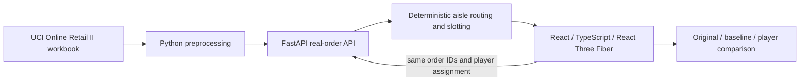

# Warehouse Intelligence Twin

Warehouse Intelligence Twin is a **NEXAI PS 4.2** browser game for warehouse slotting. It converts one month of UCI Online Retail II transactions into product demand and selected orders, then replays the same orders through original, fast-mover baseline, and player-selected layouts. A 3D picking floor shows aisle routes and measured simulation distance and time.

## Live demo and source

- **Live app:** [https://warehouse-intelligence-twin.pages.dev](https://warehouse-intelligence-twin.pages.dev)
- **Latest verified release:** [Pages deployment](https://4dd24bfe.warehouse-intelligence-twin.pages.dev)
- **Source:** [GitHub repository](https://github.com/Sanjith-Jam/warehouse-intelligence-twin)
- **Development log:** [DEV_LOG.md](DEV_LOG.md)
- **Remaining work and handoff:** [IMPLEMENTATION_PLAN.md](IMPLEMENTATION_PLAN.md)

The live frontend currently calls a FastAPI backend through a Cloudflare Quick Tunnel. The connection was verified with real June 2011 orders and all three simulation policies. The tunnel depends on local `uvicorn` and `cloudflared` processes and its hostname can expire; if that happens, the app falls back to the real-data preview without scoring. A durable backend URL is the main remaining deployment task.

## Problem and solution

Pickers can spend more time walking between shelves than collecting products. PS 4.2 asks for a digital twin driven by real order demand and a game that measures how product placement changes walking. This project preprocesses one real month, places its top 100 products in a synthetic warehouse, and lets players swap slots. The simulator routes through walkable aisle cells and returns to the packing dock after each order.

The current verified replay used the same 20 selected invoices, 1.2 m/s walking speed, 10 seconds of handling per order line, and the same synthetic 21×21 warehouse for all policies:

| Layout | Walking distance | Total estimated pick time |
|---|---:|---:|
| Original | 2,844.0 m | 3,470.0 s |
| Fast-mover baseline | 2,820.0 m | 3,450.0 s |
| Player using original assignment | 2,844.0 m | 3,470.0 s |

The baseline saves 24.0 m (0.8%) and 20 seconds across these 20 orders in this simulation. The geometry, walking speed, and handling time are assumptions, not physical warehouse measurements. The player row uses the original assignment; no claim is made that every player layout beats the baseline.

## Architecture and technology



- **Frontend:** React 19, TypeScript, Vite, Three.js, React Three Fiber, Drei, and CSS. Racks, cartons, picker, and floor use original lightweight meshes.
- **Backend and preprocessing:** Python, FastAPI, Pydantic, pandas, and deterministic breadth-first search over walkable grid cells.
- **Contract:** [`contracts/api.md`](contracts/api.md) defines the API, stable slot IDs, route invariants, and metric assumptions.
- **Hosting:** Cloudflare Pages Direct Upload for the static frontend; the current FastAPI origin is reached through an ephemeral Cloudflare Quick Tunnel.

## Local setup

Prerequisites: Node.js 22.12 or later and Python 3.11 or later.

Start the backend from the repository root:

```sh
python -m venv .venv
source .venv/bin/activate
pip install -r backend/requirements.txt
uvicorn backend.app.main:app --reload --host 127.0.0.1 --port 8000
```

In a second terminal, start the frontend:

```sh
cd frontend
npm ci
npm run dev
```

Open [http://localhost:5173](http://localhost:5173). Vite proxies `/api` to the local backend. Open [http://localhost:8000/docs](http://localhost:8000/docs) for the API docs.

Run checks from the repository root or frontend directory as appropriate:

```sh
pytest tests/ -v
cd frontend && npm test && npm run build
```

To reproduce the data export, download the UCI workbook described below and provide its path explicitly:

```sh
python scripts/preprocess_retail.py --input /path/to/online_retail_II.xlsx --sheet "Year 2010-2011" --month 2011-06
```

The default script input points to the original build environment, so use `--input` on another machine. See [`frontend/.env.example`](frontend/.env.example) and [`backend/.env.example`](backend/.env.example) for public configuration examples. Never place credentials in frontend variables.

## Data attribution and filtering

Dataset: Chen, D. (2012), **Online Retail II**, UCI Machine Learning Repository, [dataset 502](https://archive.ics.uci.edu/dataset/502/online+retail+ii), DOI [10.24432/C5CG6D](https://doi.org/10.24432/C5CG6D), licensed **CC BY 4.0**.

This release uses June 2011 from the `Year 2010-2011` worksheet. Its source workbook SHA-256 is `bcbe73b35f5b7babf197fb0cb983a11f5d9ff929078d4aa53d171b1f2df2e980`. The preprocessing filters cancellation invoices beginning with `C` (case-insensitive), missing/non-positive quantities, blank stock codes, and documented service/non-product codes before ranking the 100 most frequently picked SKUs. Frequency means retained positive order lines, not units. The first 20 eligible invoices are selected deterministically; empty orders are omitted and remaining lines are restricted to the top 100 SKUs. Missing customer IDs are retained for picking, and customer identifiers are not exposed.

[`backend/app/data/demo-provenance.json`](backend/app/data/demo-provenance.json) records source, hash, filters, counts, selection, and warehouse assumptions. The UCI workbook itself is not committed.

## Team and AI tools

- **S Sanjith** ([Sanjith-Jam](https://github.com/Sanjith-Jam)) — repository owner, frontend/integration lead, and Cloudflare Pages publisher.
- **Antigravity (AGY)** — backend/data implementation and PR contributor. The human operator's name or public handle was not included in the handoff materials.
- **AI assistance:** Codex and a Sol Medium frontend agent contributed frontend and integration work; Antigravity agents contributed backend work. See [`DEV_LOG.md`](DEV_LOG.md) for known model attribution and technical decisions. AI-generated code was reviewed before integration.

Add any other human teammates' names and handles before final submission; they were not supplied in the project files. Dependency and reference attribution is in [`THIRD_PARTY_NOTICES.md`](THIRD_PARTY_NOTICES.md).

## Deployment

Cloudflare Pages production is [warehouse-intelligence-twin.pages.dev](https://warehouse-intelligence-twin.pages.dev). The verified release is [b4229a4a.warehouse-intelligence-twin.pages.dev](https://b4229a4a.warehouse-intelligence-twin.pages.dev). This is a free static Pages deployment. The API is currently served by a local FastAPI process exposed through a temporary Quick Tunnel; this is not a durable service.

For a local public demo, run the API, start `cloudflared tunnel --url http://127.0.0.1:8000`, then rebuild and publish with the active tunnel hostname:

```sh
cd frontend
VITE_API_BASE_URL=https://<active-tunnel-host>.trycloudflare.com npm run build
npx -y wrangler@4.151.3 pages deploy dist --project-name warehouse-intelligence-twin --branch main
```

The checked-in production bundle is already configured with the current verified tunnel URL. If the tunnel stops or expires, provision a stable Python-capable backend origin, set its CORS allowlist to the Pages domain, rebuild, and redeploy. Cloudflare Pages itself serves static assets and does not run this FastAPI app.

## Remaining submission items

The required P0 simulation and real-data integration are implemented. A durable API host, final human team roster, up-to-five-minute demo recording, pitch deck, and LinkedIn/X post links remain. Track ownership and acceptance criteria in [`IMPLEMENTATION_PLAN.md`](IMPLEMENTATION_PLAN.md). Optional text-to-SQL, multi-picker congestion, batching, heatmaps, and leaderboards are deferred.
