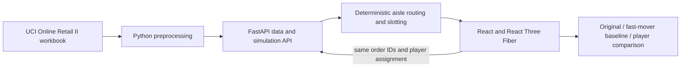

# Warehouse Intelligence Twin

Warehouse Intelligence Twin is a 3D picking-floor game for **NEXAI PS 4.2**. It uses real order demand from one month of UCI Online Retail II to populate a browser warehouse. Players swap products between fixed rack slots; the intended scoring replays the same orders against the original layout, a fast-mover baseline, and the player's layout using aisle-respecting routes.

## Current demo

- **Live app:** [warehouse-intelligence-twin.pages.dev](https://warehouse-intelligence-twin.pages.dev)
- **Repository:** [github.com/Sanjith-Jam/warehouse-intelligence-twin](https://github.com/Sanjith-Jam/warehouse-intelligence-twin)
- **Development log:** [DEV_LOG.md](DEV_LOG.md)
- **Remaining implementation plan:** [IMPLEMENTATION_PLAN.md](IMPLEMENTATION_PLAN.md)

The public site currently loads a verified June 2011 UCI preview with 100 products and 20 selected real orders. The warehouse floor and slot assignments are simulated. The FastAPI service currently uses a small synthetic fixture and has not been deployed publicly, so the live page is an **unscored preview**; it does not yet provide valid real-order before/after savings. The current backend/demo gap is tracked in the implementation plan. No savings, pick times, or performance claims are published as real results.

## Problem and solution

Pickers can spend substantial time walking between shelves. PS 4.2 asks for a digital twin driven by real order data, where the same order set is replayed after a player changes product locations. This project combines an order-data pipeline, deterministic warehouse routing, and a 3D React interface. The warehouse geometry is synthetic because Online Retail II does not include warehouse locations.

## Architecture and stack



- **Frontend:** React, TypeScript, Vite, Three.js, React Three Fiber, Drei, and CSS.
- **Backend:** Python, FastAPI, Pydantic, and pandas. Deterministic BFS routes follow walkable aisle cells and return to the packing dock.
- **Contract:** [`contracts/api.md`](contracts/api.md) defines the shared endpoints, data invariants, scoring assumptions, and response validation.
- **Data and geometry:** June 2011 source preview is in `frontend/public/demo.json`; its source, filters, workbook hash, and counts are in `frontend/public/demo-provenance.json`. A reproducible backend pipeline and real-data API integration remain to be completed.
- **Hosting:** Cloudflare Pages serves the static frontend. The backend has no public deployment yet.

## Run locally

Prerequisites: Node.js 22.12 or newer; Python 3.11 or newer for the API.

```sh
git clone https://github.com/Sanjith-Jam/warehouse-intelligence-twin.git
cd warehouse-intelligence-twin

# Terminal 1: backend
python -m venv .venv
source .venv/bin/activate
pip install -r backend/requirements.txt
uvicorn backend.app.main:app --reload --host 0.0.0.0 --port 8000

# Terminal 2: frontend
cd frontend
npm ci
npm run dev
```

Open [http://localhost:5173](http://localhost:5173). Vite proxies `/api` to `http://localhost:8000`. The currently checked-in API fixture is synthetic and is not compatible with the real-data preview's dataset identity; until AGY completes the integration, the UI remains an unscored preview. To inspect only the API fixture, visit `http://localhost:8000/docs`.

Frontend checks: `cd frontend && npm test && npm run build`. Backend checks: from the repository root, `pytest tests/ -v` after installing `backend/requirements.txt`.

For a separately hosted API, set `VITE_API_BASE_URL` to its public origin at frontend build time and configure that API's CORS allowlist for `https://warehouse-intelligence-twin.pages.dev`. See [`frontend/.env.example`](frontend/.env.example) and [`backend/.env.example`](backend/.env.example). These values are public configuration; never put credentials in frontend environment variables.

## Data attribution and rules

Dataset: Chen, D. (2012), **Online Retail II**, UCI Machine Learning Repository, [dataset 502](https://archive.ics.uci.edu/dataset/502/online+retail+ii), DOI [10.24432/C5CG6D](https://doi.org/10.24432/C5CG6D), **CC BY 4.0**. The current preview uses the 2010–2011 worksheet and June 2011. It filters case-insensitive cancellation invoice IDs beginning with `C`, non-positive or missing quantities, blank stock codes, and known non-product/service codes before ranking products by positive picking-line frequency. Missing customer IDs are retained for picking; customer identifiers are not exposed in the preview. Full provenance and source file hashes are recorded in [`frontend/public/demo-provenance.json`](frontend/public/demo-provenance.json).

The original warehouse layout, aisle geometry, 1.5 m grid cell size, picker speed, and 10-second handling time per order line are simulation assumptions, not measurements from UCI. The project must use one immutable selected order list for all three layout policies and must show actual backend results before claiming improvements.

## Team and tools

- **S Sanjith** ([Sanjith-Jam](https://github.com/Sanjith-Jam)) — repository owner, integration lead, and frontend lead.
- **Antigravity (AGY)** — backend implementation contributor; the human operator name was not provided in the project materials.
- **AI assistance:** Codex and a Sol Medium frontend agent contributed code and integration work. Specific tasks and known decisions are documented in [`DEV_LOG.md`](DEV_LOG.md). AI tools do not replace team review or understanding of the submitted code.

Libraries and reference repositories are listed in [`frontend/package.json`](frontend/package.json), [`backend/requirements.txt`](backend/requirements.txt), and [`THIRD_PARTY_NOTICES.md`](THIRD_PARTY_NOTICES.md). No code or assets were copied from the inspected warehouse references.

## Deployment

The static preview is deployed on Cloudflare Pages at [https://warehouse-intelligence-twin.pages.dev](https://warehouse-intelligence-twin.pages.dev). Updates use Cloudflare Wrangler Direct Upload; after producing `frontend/dist`, run:

```sh
cd frontend
npx -y wrangler@4.151.3 pages deploy dist --project-name warehouse-intelligence-twin --branch main
```

The Pages project is on the free static hosting path and contains no API credentials or paid services. The API still needs a public host before the deployed app can score real orders. See [IMPLEMENTATION_PLAN.md](IMPLEMENTATION_PLAN.md) for the handoff and completion gates.

## Submission materials

The live app and source repository are linked above. A demo recording, pitch deck, and LinkedIn/X post URLs have not been added to this repository yet; add them here after they are produced. Use the official `#NEXAI2026` tag in required public posts.
