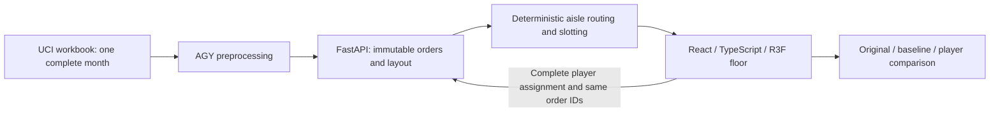

# Warehouse Intelligence Twin

PS 4.2: a browser warehouse picking game driven by one month of real UCI Online Retail II orders. Compare original, fast-movers-near-dock, and player layouts using exactly the same orders and aisle routing.

## Sprint handoff — current instructions

These ownership rules supersede conflicting role assignments in the four supplied planning documents, which are preserved as received. `contracts/api.md` is the authoritative API schema.

- Codex owns all `frontend/`, root configuration, `contracts/`, Git integration, and all merges to `main`.
- Antigravity (AGY) owns all `backend/`, `tests/`, and backend data-processing `scripts/`. No separate Codex backend worker will edit those paths.
- AGY clones into its own directory, branches from latest `main`, and opens small tested milestone PRs. Never push directly to `main`, merge a PR, force-push, or change frontend/contracts without agreement.
- Suggested branches: `agy/01-api-scaffold`, `agy/02-orders-data`, `agy/03-path-and-slotting`, `agy/04-analytics-sql`. Prioritize PS 4.2; analytics is optional.
- Each PR reports commit SHA, tests run, schema dependencies, and caveats. Update `STATUS.md` with milestone progress; PR comments carry integration questions. Do not assume either chat receives automatic notifications.
- Feature freeze at T+120 minutes; only blocker fixes, verification, and submission preparation after T+150.

## Start AGY now

```sh
git clone https://github.com/Sanjith-Jam/warehouse-intelligence-twin.git
cd warehouse-intelligence-twin
git switch -c agy/01-api-scaffold
```

Read the four supplied project Markdown files and `contracts/api.md`, using the ownership overrides above. Deliver `/health` and contract-shaped API scaffolding first, then real data and routing in focused PRs. Backend development origin is `http://localhost:8000`; allow frontend development origin `http://localhost:5173` via CORS. Backend setup commands will be supplied by AGY in its first PR.

## Data and metric integrity

UCI Online Retail II: Chen, D. (2012), https://doi.org/10.24432/C5CG6D, CC BY 4.0. Preprocess one complete month, normalize workbook columns, remove cancellations and non-product codes before ranking about 100 SKUs by pick frequency. Keep actual order IDs and the same immutable replay selection across all three layouts.

Warehouse geometry, rack positions, speed, and handling times are synthetic assumptions. Routes must follow aisles and return to the dock for each order. No measured KPIs exist yet; fixtures must be clearly labeled synthetic. The implementation will document its final layout and assumptions here.

## Current state

Frontend implementation now includes the 3D picking floor, camera presets, keyboard-accessible slot swaps, inventory/orders views, contract-based comparison, and route playback. A synthetic browser API fixture has exercised the comparison workflow. Real-data processing and backend integration remain unverified; no real savings are claimed.

## Development history and AI assistance

See [DEV_LOG.md](DEV_LOG.md) for verified milestones, failures, decisions, tests, and pending work. Codex performs integration; a Sol Medium frontend agent has been dispatched. AGY is operator-launched for backend work. Agent/model claims and test outcomes are recorded only when known; setup does not imply a completed feature.

## Frontend setup

```sh
cd frontend
npm ci
npm run dev
```

Open `http://localhost:5173`. Run AGY's backend on port 8000 when available; Vite proxies `/api`. Until then, a clearly labeled synthetic floor is inspectable, with scoring disabled. For deployment, build with `VITE_API_BASE_URL` set to the public backend origin and publish `frontend/dist`; see [frontend/README.md](frontend/README.md) and [frontend/.env.example](frontend/.env.example). That URL is public configuration, never a secret. No API key is required for PS 4.2.

## Architecture and dependencies



Frontend: React, TypeScript, Vite, Three.js, React Three Fiber, and Drei; plain CSS, original primitive rack/carton/picker meshes. Backend target: Python/FastAPI and pandas; DuckDB/SQLGlot only for optional analytics. Exact frontend versions are locked in `frontend/package-lock.json`. [THIRD_PARTY_NOTICES.md](THIRD_PARTY_NOTICES.md) records reference inspection and dependency attribution. Codex and the explicitly selected Sol Medium agent assisted development; test and review scope is recorded in DEV_LOG.md.

## Submission status

Selected problem: PS 4.2. Real month preprocessing, approximately 100 SKUs, aisle replay, and identical-orders three-layout evaluation must all work before stretch goals. PS 1.2 is an optional extension; no full text-to-SQL compliance is claimed. Demo recording (up to five minutes), PowerPoint, LinkedIn/X links with #NEXAI2026, and team member details remain to be supplied and verified. Participant instructions mention both 3:00 PM and around 3:30 PM on 22 October 2026; use the earlier time for preparation until organizers clarify.

## Cloudflare Pages deployment

Production: https://warehouse-intelligence-twin.pages.dev

Verified deployment: https://2ce31c6d.warehouse-intelligence-twin.pages.dev (source main `6089b88`). Static assets only; no Pages Functions, paid services, or plan upgrade were provisioned for this Pages project. At this milestone, the backend is not configured publicly, so the preview is labeled synthetic and comparison scoring is disabled.

After building in `frontend/`, deploy a later verified milestone with:

```sh
npx -y wrangler@4.151.3 pages deploy dist --project-name warehouse-intelligence-twin --branch main
```

Use the same Cloudflare account and set `VITE_API_BASE_URL` to the verified public backend origin before building when available. Credentials remain in the local OAuth store, outside this repository. This is a Direct Upload Pages project; updates use the command above. Switching this project to Git integration later requires a new Pages project, per [Cloudflare Direct Upload documentation](https://developers.cloudflare.com/pages/get-started/direct-upload/).

## Real-data frontend preview

The operations frontend includes a read-only UCI June 2011 export in `frontend/public/demo.json`: 100 real SKUs ranked by picking-line frequency and 20 real selected invoices. `frontend/public/demo-provenance.json` records source hash, filters, actual counts and assumptions. The source month has 36,874 rows; 35,857 positive product lines survive the documented filters; the top 100 account for 8,927 lines across 1,284 invoices. Missing customers are retained for picking; customer identifiers are omitted from the preview.

This static export supports inspection and local slot changes when the API is unavailable; scoring and playback remain disabled until the authoritative matching backend is connected. No savings are claimed from static data. AGY owns the reproducible full-month backend preprocessing milestone. The 21×21 grid, 1.5m cells, 100 racks, aisle geometry, and Random(42) initial slot assignments are synthetic.
