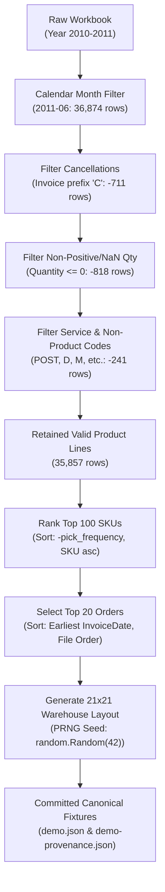

# Dataset Preprocessing and Reproducibility Guide

This guide documents the authoritative, deterministic preprocessing pipeline, mathematical invariants, provenance tracking, and reproducibility verification mechanisms for the **UCI Online Retail II** dataset and synthetic layouts used by the Warehouse Intelligence Twin simulation.

---

## 1. Provenance and Source Citation

- **Dataset:** Online Retail II (Chen, D., 2012)
- **DOI:** [10.24432/C5CG6D](https://doi.org/10.24432/C5CG6D)
- **License:** Creative Commons Attribution 4.0 International (CC BY 4.0)
- **Official UCI Page:** [https://archive.ics.uci.edu/dataset/502/online+retail+ii](https://archive.ics.uci.edu/dataset/502/online+retail+ii)
- **Direct Download URL:** [https://archive.ics.uci.edu/static/public/502/online+retail+ii.zip](https://archive.ics.uci.edu/static/public/502/online+retail+ii.zip)
- **Official Source Workbook:** `online_retail_II.xlsx` (contains sheets `Year 2009-2010` and `Year 2010-2011`)
- **Official Workbook SHA-256:** `bcbe73b35f5b7babf197fb0cb983a11f5d9ff929078d4aa53d171b1f2df2e980`
- **Target Sheet:** `Year 2010-2011`
- **Target Calendar Month:** June 2011 (`2011-06`)

### Canonical Snapshot Fixture Hashes

| Artifact Path | Format | SHA-256 Checksum |
| :--- | :--- | :--- |
| `backend/app/data/demo.json` | JSON | `c362a076ca534716185df93f2587528fef3ec611ff0090574c421d402c3efc7a` |
| `frontend/public/demo.json` | JSON | `c362a076ca534716185df93f2587528fef3ec611ff0090574c421d402c3efc7a` |
| `backend/app/data/demo-provenance.json` | JSON | `9fecae9ed4bb48601a39b491ca416dbad782ae5d22358ba1d5c36d2bc966fd06` |
| `frontend/public/demo-provenance.json` | JSON | `9fecae9ed4bb48601a39b491ca416dbad782ae5d22358ba1d5c36d2bc966fd06` |

---

## 2. Invariants and Deterministic Preprocessing Pipeline

The preprocessing pipeline (`scripts/preprocess_retail.py` and `backend.app.services.preprocessing`) executes a series of deterministic cleaning and filtering steps. Every step follows strict mathematical tie-breaking rules to guarantee bitwise reproducibility across platforms and Python runs:



### 2.1 Calendar Month Handling
- Filters records where `InvoiceDate` falls strictly within the ISO-8601 month `2011-06` (June 1, 2011 00:00:00 through June 30, 2011 23:59:59).
- Total rows in sheet `Year 2010-2011` matching June 2011: **36,874 rows**.

### 2.2 Exclusions and Data Cleaning

1. **Cancellation Filter:**
   - Any invoice number starting with `"C"` or `"c"` (case-insensitive string prefix) is classified as a cancellation and excluded.
   - Rows excluded: **711 rows**.
2. **Non-Positive / Missing Quantity:**
   - Any row where `Quantity <= 0` or where `Quantity` is NaN/null is excluded (returns, adjustments, damages, data entry errors).
   - Rows excluded: **818 rows**.
3. **Non-Product and Service Codes:**
   - The following non-physical service codes, freight charges, bank fees, and administrative adjustments are excluded:
     - `POST`: Postage fees
     - `DOT`: Dotcom postage charges
     - `M`: Manual entries / adjustments
     - `D`: Discount / fee concessions
     - `BANK CHARGES`: Banking transaction charges
     - `AMAZONFEE`: Amazon platform handling fees
     - `C2`: Carriage charges
     - `CRUK`: Cancer Research UK charity donations
     - `S`: Samples
     - `PADS`: Internal cushion pads / packing material
     - `B`: Bad debt write-offs
     - `ADJUST` / `ADJUST2`: Inventory balance adjustments
     - `TEST001` / `TEST002`: Internal test accounts
     - `SAMPLES`: Sample distributions
   - Blank / whitespace-only SKU strings are also excluded.
   - Rows excluded: **241 rows**.
4. **Retained Valid Positive Product Lines:**
   - Exactly **35,857 lines** remain after applying all exclusion criteria.

### 2.3 Pick Frequency Definition
- **Definition:** The pick frequency for a given SKU is defined as the **number of retained picking line rows** across the target calendar month.
- **Rationale:** In physical warehouse picking, each order line represents a distinct stop/visit by an order picker to a rack slot, irrespective of the unit quantity picked (e.g., picking 5 units from one slot incurs 1 pick stop, not 5 travel trips).

### 2.4 Deterministic Ranking & Tie-Breaking Rules

1. **Top-100 SKU Selection:**
   - Primary key: `-pick_frequency` (descending pick frequency).
   - Secondary tie-break: ascending alphanumeric SKU string (`sku`).
   - Resolves all potential platform-dependent dictionary iteration differences.
2. **Product Name Resolution:**
   - The descriptive product name assigned to each SKU is the **first observed non-null, non-blank description** in stable source row order.
3. **Order Selection & Tie-Breaking:**
   - First 20 multi-line invoices by earliest retained line timestamp (`InvoiceDate`).
   - Tie-break for identical timestamps: first observed invoice appearance order in source workbook rows.
   - Order lines are filtered to include only lines matching the retained top 100 SKUs, preserved in order of appearance.
4. **Initial Warehouse Layout & Slot Allocation:**
   - 21x21 grid (1.5 m cell pitch), orthogonal aisles where `x % 2 == 0` or `z % 2 == 0`.
   - 100 rack slots on odd/odd coordinates (`x, z ∈ {1, 3, 5, 7, 9, 11, 13, 15, 17, 19}`).
   - Southern access cell `[x, z - 1]` for each rack.
   - Initial slot-to-SKU assignment is generated using a seeded pseudo-random number generator (`random.Random(42)`) to provide an unbiased, non-optimized original layout baseline.

---

## 3. Clean-Checkout Reproduction Instructions

### 3.1 CLI Preprocessing Commands

The CLI tool `scripts/preprocess_retail.py` reproduces the canonical fixtures from source:

```bash
# 1. Download official UCI zip file
mkdir -p datasets/online-retail-ii
curl -fsSL -o datasets/online-retail-ii/online-retail-ii.zip "https://archive.ics.uci.edu/static/public/502/online+retail+ii.zip"
unzip -q datasets/online-retail-ii/online-retail-ii.zip -d datasets/online-retail-ii/

# 2. Verify official workbook SHA-256 checksum
echo "bcbe73b35f5b7babf197fb0cb983a11f5d9ff929078d4aa53d171b1f2df2e980  datasets/online-retail-ii/online_retail_II.xlsx" | sha256sum -c -

# 3. Execute deterministic preprocessing with frontend synchronization
python scripts/preprocess_retail.py \
  --input datasets/online-retail-ii/online_retail_II.xlsx \
  --sheet "Year 2010-2011" \
  --month "2011-06" \
  --top-skus 100 \
  --orders 20 \
  --sync-frontend

# 4. Verify byte-identity against committed fixtures
diff -u backend/app/data/demo.json frontend/public/demo.json
diff -u backend/app/data/demo-provenance.json frontend/public/demo-provenance.json
git status  # Must show no changes to demo.json or demo-provenance.json
```

### CLI Flag Reference (`scripts/preprocess_retail.py`)

| Flag | Short | Default | Description |
| :--- | :--- | :--- | :--- |
| `--input` | `-i` | `$UCI_DATASET_PATH` or standard paths | Path to `online_retail_II.xlsx`. |
| `--sheet` | `-s` | `Year 2010-2011` | Excel sheet name to process. |
| `--month` | `-m` | `2011-06` | Target calendar month (`YYYY-MM`). |
| `--top-skus`| `-k` | `100` | Number of high-velocity SKUs to retain. |
| `--orders`  | `-n` | `20` | Number of order picking batches to extract. |
| `--output`  | `-o` | `backend/app/data/demo.json` | Primary output JSON path. |
| `--sync-frontend` | | `False` | Also copy output to `frontend/public/`. |
| `--allow-hash-mismatch` | | `False` | Bypass source workbook SHA-256 check (for testing). |

---

## 4. REST API Endpoints for Dataset Reproduction and Lifecycle

The backend exposes a complete set of endpoints to upload, preprocess, inspect, export, and simulate datasets:

### 4.1 `POST /api/datasets/upload`
Uploads raw CSV or Excel files. Generates an isolated dataset identifier (`ds_<uuid>`), auto-detects column headers using alias matching (`invoice`, `sku`, `quantity`, `date`, `description`), and scans available calendar months.

```bash
curl -X POST "http://localhost:8000/api/datasets/upload" \
  -F "file=@datasets/online-retail-ii/online_retail_II.xlsx"
```

### 4.2 `POST /api/datasets/{dataset_id}/preprocess`
Executes the deterministic preprocessing pipeline on a staged upload. Accepts:
- `target_month` (e.g. `"2011-06"`)
- `top_skus` (default `100`)
- `max_orders` (default `20`)
- `sheet_name` (optional sheet name)
- `column_mapping` (optional explicit column header overrides)

```bash
curl -X POST "http://localhost:8000/api/datasets/ds_12345/preprocess" \
  -H "Content-Type: application/json" \
  -d '{"target_month": "2011-06", "top_skus": 100, "max_orders": 20}'
```

### 4.3 `GET /api/datasets/{dataset_id}`
Returns the complete dataset snapshot: `meta`, `cleaning_report` (provenance counters), `layout` (walkable cells, dock, slots), `products`, and `orders`.

### 4.4 `GET /api/datasets/{dataset_id}/export?format=json|csv` & `download`
Prepares and downloads structured snapshots in JSON or CSV format.

### 4.5 `POST /api/datasets/{dataset_id}/simulate`
Replays a frozen list of orders across three policies:
1. `original`: Initial layout slotting.
2. `baseline`: Automated fast-mover policy (highest-velocity SKUs closest to dock).
3. `player`: User-submitted layout permutation mapping.

```bash
curl -X POST "http://localhost:8000/api/datasets/demo/simulate" \
  -H "Content-Type: application/json" \
  -d '{"speed_m_s": 1.2, "handling_time_s": 15.0}'
```

### 4.6 Snapshot Immutability Enforcement
The official demo dataset (`demo` / `uci-online-retail-ii-june-2011`) is **strictly immutable**. Any attempt to re-preprocess or overwrite it via `POST /api/datasets/demo/preprocess` is rejected with HTTP 422:
```json
{
  "detail": {
    "code": "IMMUTABLE_DATASET",
    "message": "Cannot overwrite built-in demo dataset"
  }
}
```

---

## 5. How Automated Tests Verify Reproducibility and Immutability

The test suite enforces mathematical and snapshot invariants on every test run:

### 5.1 Canonical Hash Identity & Byte Matching (`tests/test_preprocess.py`)
- `test_backend_frontend_fixture_byte_identity`: Reads `backend/app/data/demo.json` and `frontend/public/demo.json`, computes their SHA-256 hashes, and asserts that they are **strictly identical**.
- `test_backend_frontend_provenance_identity`: Compares `demo-provenance.json` between backend and frontend, validating that row counters (36,874 month rows, 711 cancelled, 818 non-positive quantity, 241 non-product, 35,857 retained lines) and source SHA-256 match perfectly.
- `test_synthetic_workbook_repeat_generation_deterministic`: Executes repeat preprocessing passes on synthetic Excel workbooks to verify that consecutive runs produce byte-for-byte identical JSON.
- `test_preprocess_checksum_validation_failure`: Verifies that corrupted or modified source workbooks are immediately rejected with actionable SHA-256 error messages.

### 5.2 Snapshot Immutability & Multi-Tenant Isolation (`tests/test_dataset_lifecycle.py`)
- `test_demo_dataset_preprocess_rejected`: Confirms that the built-in demo dataset cannot be modified via the API, rejecting mutations with `ErrorCode.IMMUTABLE_DATASET`.
- `test_two_datasets_isolation_no_cross_contamination`: Uploads two distinct datasets in sequence and asserts that their product catalogs, orders, and staging directories remain strictly isolated with no cross-contamination.

### 5.3 Controlled Geometry Swap Verification (`tests/test_controlled_swap_fixture.py`)
- Constructs controlled synthetic warehouse fixtures where SKU pick velocities and slot distances are analytically controlled:
  - `SKU-HOT`: 50 picks (high velocity)
  - `SKU-COLD`: 1 pick (low velocity)
  - `S001`: near slot (1 step from dock = 1.5 m; round-trip = 3.0 m)
  - `S050`: far slot (27 steps from dock = 40.5 m; round-trip = 81.0 m)
- Proves mathematically that swapping a bad placement (HOT far, COLD near) to an optimized placement (HOT near, COLD far) reduces walking distance from **4,053.0 m** to **231.0 m** (saving 3,822.0 m).
- Proves that the automated baseline policy automatically places high-velocity items near the dock and **matches or beats** player permutations.
- Verifies that all 3 policies simulate the **exact same frozen order list** using exact formulas:
  $$\text{Distance} = \sum \text{steps} \times \text{cell\_size\_m}$$
  $$\text{Pick Time} = \frac{\text{Distance}}{\text{speed\_mps}} + (\text{line\_count} \times \text{handling\_seconds\_per\_line})$$

---

## 6. Official June 2011 Expected Simulation Metrics

The canonical June 2011 dataset produces exact, repeatable simulation metrics across both backend simulation endpoints and frontend verification:

| Metric | Original Policy | Fast-Mover Baseline | Improvement |
| :--- | :--- | :--- | :--- |
| **Walking Distance** | 2,844.0 m | 2,820.0 m | -24.0 m (-0.84%) |
| **Picking Time (at 5s/line)** | 3,470.0 s | 3,450.0 s | -20.0 s (-0.58%) |
| **Picking Time (at 15s/line)**| 4,070.0 s | 4,050.0 s | -20.0 s (-0.49%) |
| **Selected Orders** | 20 | 20 | Identical frozen order batch |
| **SKUs Slotted** | 100 | 100 | 100 rack slots (21x21 grid) |
| **Walking Speed** | 1.2 m/s | 1.2 m/s | Standard parameter |
| **Grid Cell Pitch** | 1.5 m | 1.5 m | Orthogonal grid step |

---

## 7. Git Repository Safety

The original 44 MB workbook must **never** be committed to Git. The project `.gitignore` explicitly ignores:
- `*.xlsx`
- `*.xls`
- `datasets/`
- `data/raw/`
